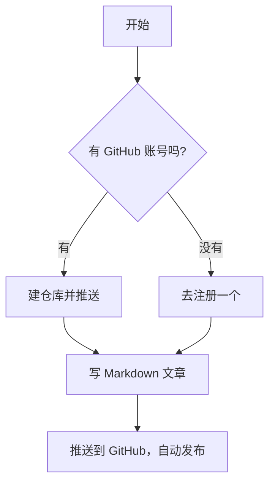

这是我的第一篇博客，由 **GitHub Pages + Jekyll** 自动构建。

## 怎么写文章

在 `_posts` 目录里新建 `YYYY-MM-DD-标题.md` 文件，开头写上面的 front matter（`layout: post` + `title` + `date`），下面就是普通 Markdown。

## 流程图（Mermaid）

代码块语言标识写成 `mermaid` 就能出流程图：



## 其他 Markdown 语法照常

- **加粗**、*斜体*、~~删除线~~
- 列表、表格、引用
- 代码高亮：```python 这种写法也支持
