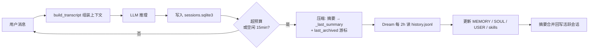

最近在折腾 [nanobot](https://github.com/yorkie-labs/nanobot)——一个本地运行的 LLM 助手框架。它最吸引我的不是模型本身，而是**把"上下文"当成一个正经工程问题来设计**。这篇是它的三层记忆架构拆解：会话内压缩、Dream 定时归档、跨会话检索。

## 问题：上下文是稀缺资源

LLM 的上下文窗口再大也是有限的（本实例 200K tokens）。朴素方案只有两种，都不可用：

- **全量塞进 prompt**：聊几轮就爆窗口
- **只留最后几条**：模型秒变金鱼记忆

nanobot 的做法是把记忆拆成三层，各管各的，两层链路彻底解耦：

| 层 | 干什么 | 触发时机 |
|---|---|---|
| ① 会话内压缩 | 长会话压成摘要 | 超预算 / 空闲 15min |
| ② Dream 定时归档 | 摘要沉淀为长期记忆 | 每 2h |
| ③ 跨会话检索 | 需要时翻历史记录 | 工具显式调用 |



## 第一层：build_transcript 组装顺序

每一轮对话，system prompt 的拼装是固定管线：

```
identity → SOUL.md → USER.md → AGENTS.md → 工具契约
        → MEMORY.md → Skills → [Archived Context Summary]
        → 本会话 last_archived 之后的全部 turn → 当前消息
```

两个关键设计：

1. **其他会话的历史永不自动加载**。只有 `search_sessions` / `read_session` 被调用时，结果才以 tool 消息临时注入当前这一轮。这是"会话隔离"的根基：不同会话之间默认零感知，只有显式检索才打通。
2. `[Archived Context Summary]` 是上一轮压缩留下的摘要，放在 system prompt 开头，让模型"带着记忆"开始本轮，而不是从零推理。

预算计算也很直白：`200K 窗口 − 50K 输出 − 1K 安全余量 ≈ 149K tokens`。超过就触发压缩，而不是硬塞。

## 第二层：会话内压缩（不写 history.jsonl）

触发条件二选一：

- 上下文超预算（≈ 149K tokens）
- 空闲超过 15 分钟

压缩动作三步：

1. 把历史对话总结成摘要
2. 写入 sqlite `sessions.metadata._last_summary`
3. 推进 `last_archived` 游标——下次组装从游标之后开始

注意：这一层**不写** `history.jsonl`。`history.jsonl` 只是归档摘要日志，完整记录以 sqlite 为准。这个区分很重要，别把两个链路搞混。

## 第三层：Dream 定时归档（唯一的长期记忆入口）

Dream 是 nanobot 的"睡眠记忆"机制，`intervalH=2` 每 2 小时跑一次。它消费 `history.jsonl`（普通对话 prompt 里完全引用不到它，是 Dream 的专属输入），用 `.dream_cursor` 记账只处理新增条目。

输出落盘四条路：

- `MEMORY.md` —— 项目事实、重要结论
- `SOUL.md` —— agent 行为准则
- `USER.md` —— 用户画像
- `skills/` —— 可复用流程（出现 ≥2 次才建）

然后把摘要合并写回活跃会话的 `_last_summary`。所以短期记忆（会话摘要）逐级沉淀为长期记忆（MEMORY/SOUL/USER），这就是"记得住"的关键。

Dream 的 prompt 也很讲究：普通 agent system prompt + dream.md 模板（文件路由表、属性标签 skip/correction/permanent/durable/ephemeral、清理规则、技能门槛、编辑纪律）+ 最多 20 条 × 1000 字符的会话历史截断，并且工具受限（只读 workspace + 内置技能目录，写 skills + MEMORY/SOUL/USER，无 exec/web/message）。

## 检索层：跨会话搜索

`search_sessions` / `read_session` 底层链路：`SessionHistoryReader → SessionManager → SqliteSessionStore`，直接查 `sessions.sqlite3` 的全量 messages——包括 checkpoint 之前的历史，**不依赖** `history.jsonl`。

搜索算法是朴素子串匹配：标题优先（`==` / `startswith` / `contains` 三级排序），内容从新到旧逐条扫描。没有索引、没有正则、没有语义检索——搜「配对」找不到「pairing」。这是设计取舍，不是 bug：单用户自托管场景，朴素匹配够用且零成本。

会话隔离还有几道墙：

1. **workspace 物理隔离**：不同 workspace 是不同 sqlite 文件
2. **session_type 隔离**：`conversation` 可被搜索，`subagent` / `dream` 会话不可搜
3. **消息级过滤**：`_hidden_history` / `_command` 消息不进入检索
4. **排除当前会话**：搜索不回搜自己
5. **多租户边界在 workspace 级**：同一 workspace 内无 ACL（单用户自托管设计）

## 小结

| 层 | 数据源 | 写入目标 | 触发 |
|---|---|---|---|
| 会话内压缩 | 当前会话 turn | sqlite `_last_summary` + 游标 | 超预算 / 空闲 15min |
| Dream 归档 | `history.jsonl` | MEMORY / SOUL / USER / skills | 每 2h |
| 跨会话检索 | `sessions.sqlite3` | 临时注入当轮 | 工具显式调用 |

三层各司其职：**压缩**解决单会话长度，**Dream** 解决跨会话记忆，**检索**解决精确回看。

最值得借鉴的两条设计：

1. **归档摘要不进普通 prompt，只给 Dream 专用**——把"对话记忆"和"长期记忆"两条链路彻底解耦，普通对话永远只看到自己的压缩摘要，不会膨胀。
2. **游标记账而非全量重读**——`last_archived` / `.dream_cursor` 都是增量处理，长跑不退化。

如果你的 LLM 应用也在被上下文窗口折磨，这三层架构是个不错的参考模板。
