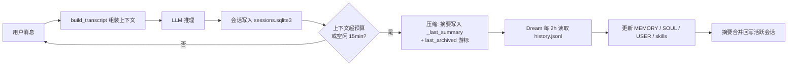

最近在折腾 [nanobot](https://github.com/yorkie-labs/nanobot)，一个本地跑的 LLM 助手框架。它最大的卖点不是模型本身，而是**把"上下文"当成一个正经工程问题来设计**。这篇记录一下它的三层记忆架构。

## 问题：上下文是稀缺资源

LLM 的上下文窗口再大也是有限的（本实例 200K tokens）。一个助手如果只靠"把所有聊天记录塞进 prompt"，聊几轮就爆了；如果只保留最后几条，又会失忆。

nanobot 的做法是把记忆拆成三层，各管各的：

1. **会话内压缩** —— 同一会话聊太久，把历史压成摘要
2. **Dream 定时归档** —— 每 2 小时把已压缩的会话摘要沉淀进长期记忆
3. **跨会话检索** —— 需要时主动去翻历史聊天记录



## 第一层：build_transcript 组装顺序

每一轮对话，system prompt 的拼装顺序是固定管线：

```
identity → SOUL.md → USER.md → AGENTS.md → 工具契约
        → MEMORY.md → Skills → [Archived Context Summary]
        → 本会话 last_archived 之后的全部 turn → 当前消息
```

几个关键点：

- **其他会话的历史永不自动加载**。只有 `search_sessions` / `read_session` 工具被调用时，结果才以 tool 消息的形式临时注入当前这一轮。
- `[Archived Context Summary]` 就是上一轮压缩留下的摘要，放在 system prompt 里，让模型"带着记忆"开始本轮。

## 第二层：会话内压缩

触发条件有两个（任一即可）：

- 上下文超预算（本实例 ≈ 149K tokens = 200K 窗口 − 50K 输出 − 1K 安全余量）
- 空闲超过 15 分钟

压缩动作：

- 把历史对话总结成摘要
- 写入 sqlite `sessions.metadata._last_summary`
- 推进 `last_archived` 游标（下次从游标之后开始拼）

注意：这一层**不写** `history.jsonl`。

## 第三层：Dream 定时归档

Dream 是 nanobot 的"睡眠记忆"机制，每 2 小时（`intervalH=2`）跑一次：

- 读取 `history.jsonl`（普通对话 prompt 里完全引用不到它，它是 Dream 的专属输入）
- 用 `.dream_cursor` 记账，只处理新增条目
- 输出落盘：更新 `MEMORY.md`（项目事实）、`SOUL.md`（行为）、`USER.md`（用户画像）、必要时新建/更新 skills
- 把摘要合并写回活跃会话的 `_last_summary`

所以短期记忆（会话摘要）会逐级沉淀为长期记忆（MEMORY/SOUL/USER），这就是"记得住"的关键。

## 检索层：跨会话搜索

`search_sessions` / `read_session` 底层是 `SessionHistoryReader → SessionManager → SqliteSessionStore`，直接查 `sessions.sqlite3` 的全量 messages——包括 checkpoint 之前的历史，**不依赖** `history.jsonl`。

搜索算法是朴素的子串匹配（标题优先三级排序，内容从新到旧逐条扫描），没有索引、没有正则、没有语义检索。搜「配对」找不到「pairing」——这是设计取舍，不是 bug。

## 小结

| 层 | 数据源 | 写入目标 | 触发 |
|---|---|---|---|
| 会话内压缩 | 当前会话 turn | sqlite `_last_summary` + 游标 | 超预算 / 空闲 15min |
| Dream 归档 | `history.jsonl` | MEMORY / SOUL / USER / skills | 每 2h |
| 跨会话检索 | `sessions.sqlite3` | （临时注入当轮） | 工具显式调用 |

三层各司其职：**压缩**解决单会话长度，**Dream** 解决跨会话记忆，**检索**解决精确回看。这个架构挺值得借鉴——尤其"归档摘要不进普通 prompt，只给 Dream 专用"这条，把两个链路彻底解耦了。
