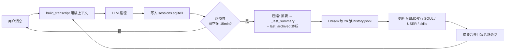

最近在折腾 [nanobot](https://github.com/yorkie-labs/nanobot)——一个本地运行的 LLM 助手框架。它最吸引我的不是模型本身，而是**把"记忆"当成一个正经工程问题来设计**。这篇拆解它的三层记忆架构，分两大部分：先厘清 memory 和 context 这对常被混用的概念，再用"总分总"的方式讲清楚三层架构到底怎么运转。

## 一、先分清：Memory 与 Context

### 1.1 Context：模型"此刻"看到什么

**Context（上下文）**是某一轮请求实际喂给 LLM 的 prompt——system prompt + 历史 turn + 当前消息。它有三个特征：

- **瞬时**：每一轮都重新构建，用完即弃
- **每轮重建**：下一轮对话不会继承上一轮的 prompt 对象
- **受窗口限制**：200K 的窗口装不下，就触发压缩

所以 context 的管理动作只有两个：**组装**（build_transcript 把各来源拼成一份 prompt）和**超预算压缩**（窗口快满时把历史压成摘要）。

### 1.2 Memory：模型"事后"还记得什么

**Memory（记忆）**是跨轮 / 跨会话保留的信息，载体有三类：

- 会话摘要：sqlite 里的 `_last_summary`
- 长期档案：MEMORY.md / SOUL.md / USER.md
- 全量原始记录：sessions.sqlite3 的 messages 表

它有完整的生命周期：**写 → 沉淀 → 读**。对应到 nanobot 就是三层架构——会话内压缩负责写、Dream 定时归档负责沉淀、跨会话检索负责读。

### 1.3 一张表分清

| 维度 | Context | Memory |
|---|---|---|
| 本质 | 每轮喂给模型的 prompt | 跨轮 / 跨会话保留的信息 |
| 生命周期 | 组装 → 推理 → 丢弃 | 写 → 沉淀 → 读 |
| 存储 | 无（内存中的临时结构） | 有（sqlite / Markdown 文件） |
| 管理动作 | 组装、超预算压缩 | 压缩落盘、Dream 归档、检索 |
| 时间尺度 | 单轮 | 跨会话、跨天 |

一句话总结：**context 是"模型此刻看到什么"，memory 是"模型事后还记得什么"**。两者不是割裂的——memory 是 context 的数据源（摘要、长期档案都会拼进 prompt），context 是 memory 的消费出口（模型只有通过 context 才能"用上"记忆），中间靠 `_last_summary` 桥接。

本文的三层架构属于 **memory 管理**：三层全是记忆的生命周期环节。context 管理只出现在"组装"和"超预算压缩"两个动作里——它们分别是记忆的消费出口、以及第一层压缩的触发点，下文会看到它们如何嵌入三层架构。

## 二、nanobot 的三层记忆架构（总分总）

### 2.1 总体：三层解决一个核心矛盾

先看问题。LLM 的上下文窗口再大也是有限的（本实例 200K tokens），而朴素方案只有两种，都不可用：

- **全量塞进 prompt**：聊几轮就爆窗口
- **只留最后几条**：模型秒变金鱼记忆

nanobot 的做法是把记忆拆成三层，每层负责生命周期的一段，两条链路彻底解耦：

| 层 | 生命周期环节 | 干什么 | 触发时机 |
|---|---|---|---|
| ① 会话内压缩 | 写 | 长会话压成摘要落盘 | 超预算 / 空闲 15min |
| ② Dream 定时归档 | 沉淀 | 摘要升级为长期记忆 | 每 2h |
| ③ 跨会话检索 | 读 | 需要时翻全量历史 | 工具显式调用 |



整个架构的主线是一条记忆生命周期：**会话产生 → 压缩写入 → Dream 沉淀 → 检索读取 → 拼进下一轮 context**。短期记忆（会话摘要）逐级沉淀为长期记忆（MEMORY / SOUL / USER），再通过检索回到 context——这就是"记得住"的完整闭环。

### 2.2 分述：每一层怎么运转

#### 第一层：会话内压缩——记忆的"写"

触发条件二选一：

- 上下文超预算（≈ 149K tokens，计算：`200K 窗口 − 50K 输出 − 1K 安全余量`）
- 空闲超过 15 分钟

压缩动作三步：

1. 把历史对话总结成摘要
2. 写入 sqlite `sessions.metadata._last_summary`
3. 推进 `last_archived` 游标——下次组装从游标之后开始

注意：这一层**不写** `history.jsonl`。`history.jsonl` 只是归档摘要日志，完整记录以 sqlite 为准。这个区分很重要，别把两条链路搞混。

压缩产物怎么被消费？看组装管线。每一轮对话，system prompt 的拼装是固定管线：

```
identity → SOUL.md → USER.md → AGENTS.md → 工具契约
        → MEMORY.md → Skills → [Archived Context Summary]
        → 本会话 last_archived 之后的全部 turn → 当前消息
```

两个关键设计：

1. **`[Archived Context Summary]` 就是上一轮压缩留下的 `_last_summary`**，放在 system prompt 开头，让模型"带着记忆"开始本轮——这是 memory 进入 context 的桥。
2. **其他会话的历史永不自动加载**。只有 `search_sessions` / `read_session` 被调用时，结果才以 tool 消息临时注入当前这一轮。这是"会话隔离"的根基：不同会话之间默认零感知，只有显式检索才打通。

#### 第二层：Dream 定时归档——记忆的"沉淀"

Dream 是 nanobot 的"睡眠记忆"机制，`intervalH=2` 每 2 小时跑一次。它消费 `history.jsonl`（普通对话 prompt 里完全引用不到它，是 Dream 的专属输入），用 `.dream_cursor` 记账只处理新增条目。

输出落盘四条路：

- `MEMORY.md` —— 项目事实、重要结论
- `SOUL.md` —— agent 行为准则
- `USER.md` —— 用户画像
- `skills/` —— 可复用流程（出现 ≥2 次才建）

然后把摘要合并写回活跃会话的 `_last_summary`。至此，第一层写下的短期记忆完成向长期记忆的升级——"写"和"沉淀"两级接力，这就是"记得住"的关键。

Dream 的 prompt 也很讲究：普通 agent system prompt + dream.md 模板（文件路由表、属性标签 skip/correction/permanent/durable/ephemeral、清理规则、技能门槛、编辑纪律）+ 最多 20 条 × 1000 字符的会话历史截断，并且工具受限（只读 workspace + 内置技能目录，写 skills + MEMORY/SOUL/USER，无 exec/web/message）。

#### 第三层：跨会话检索——记忆的"读"

`search_sessions` / `read_session` 底层链路：`SessionHistoryReader → SessionManager → SqliteSessionStore`，直接查 `sessions.sqlite3` 的全量 messages——包括 checkpoint 之前的历史，**不依赖** `history.jsonl`。

搜索算法是朴素子串匹配：标题优先（`==` / `startswith` / `contains` 三级排序），内容从新到旧逐条扫描。没有索引、没有正则、没有语义检索——搜「配对」找不到「pairing」。这是设计取舍，不是 bug：单用户自托管场景，朴素匹配够用且零成本。

检索结果以 tool 消息临时注入当轮 context——这就是"读"的出口：**记忆最终还是要回到 context 里被模型消费**，闭环在此合拢。

会话隔离还有几道墙（防止"读"变成"偷看"）：

1. **workspace 物理隔离**：不同 workspace 是不同 sqlite 文件
2. **session_type 隔离**：`conversation` 可被搜索，`subagent` / `dream` 会话不可搜
3. **消息级过滤**：`_hidden_history` / `_command` 消息不进入检索
4. **排除当前会话**：搜索不回搜自己
5. **多租户边界在 workspace 级**：同一 workspace 内无 ACL（单用户自托管设计）

### 2.3 总收：三层如何协同

| 层 | 生命周期 | 数据源 | 写入目标 | 触发 |
|---|---|---|---|---|
| 会话内压缩 | 写 | 当前会话 turn | sqlite `_last_summary` + 游标 | 超预算 / 空闲 15min |
| Dream 归档 | 沉淀 | `history.jsonl` | MEMORY / SOUL / USER / skills | 每 2h |
| 跨会话检索 | 读 | `sessions.sqlite3` | 临时注入当轮 | 工具显式调用 |

三层各司其职：**压缩**解决单会话长度，**Dream** 解决跨会话记忆，**检索**解决精确回看。合起来是一条完整的生命周期：写 → 沉淀 → 读 → 回到 context。

最值得借鉴的两条设计：

1. **归档摘要不进普通 prompt，只给 Dream 专用**——把"对话记忆"和"长期记忆"两条链路彻底解耦，普通对话永远只看到自己的压缩摘要，不会膨胀。
2. **游标记账而非全量重读**——`last_archived` / `.dream_cursor` 都是增量处理，长跑不退化。

如果你的 LLM 应用也在被上下文窗口折磨，这套"写 → 沉淀 → 读"的三层模板可以直接抄作业。
