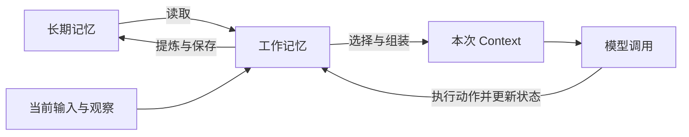
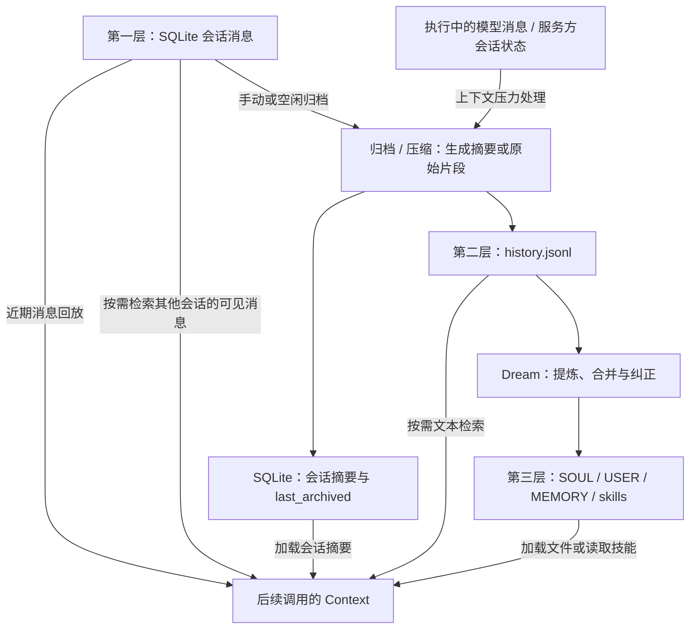

本文基于 [HKUDS/nanobot 的 `v0.4.0` tag](https://github.com/HKUDS/nanobot/tree/v0.4.0) 介绍记忆管理的设计与实现。

在介绍 nanobot 的记忆管理之前，先了解 Context 和 Memory 的概念及其关系。

## 一、Context 与 Memory

### 1.1 两个概念

**Context（上下文）** 是一次模型调用实际接收到的信息，包括指令、当前问题、选入的历史对话、工具结果和记忆。它受 Context Window（上下文窗口）的容量限制。同一轮用户交互可能包含多次模型调用，每次调用的 Context 也可以不同。<sup><a href="#ref-1">[1]</a></sup>

**Memory（记忆）** 是 Agent 保留和复用信息的机制，涉及保存、读取、更新和删除。它既可以服务于当前任务，也可以跨会话保存用户偏好、项目约定和经验。<sup><a href="#ref-2">[2]</a></sup> 记忆可以保存在 Markdown 文件、JSONL 日志或 SQLite 数据库中，保存多久、在哪些会话中使用，取决于系统设计。

两者关注的问题不同：Context 关注“模型这次看到什么”，Memory 关注“Agent 如何保留信息并在之后复用”。例如，“默认用中文回答”保存在用户档案里，是一条记忆；系统读取它并加入模型输入后，它也成为本次 Context 的一部分。

### 1.2 记忆的分类

论文《Cognitive Architectures for Language Agents》提出了 CoALA 框架，将记忆分为工作记忆和长期记忆，其中长期记忆又分为情节记忆、语义记忆和程序记忆。<sup><a href="#ref-3">[3]</a></sup>

| 类型 | 内容与例子 |
|---|---|
| 工作记忆（Working Memory） | 当前决策需要的目标、状态、观察和工具结果 |
| 情节记忆（Episodic Memory） | 过去的经历，如一次排障的过程和结果 |
| 语义记忆（Semantic Memory） | 事实与知识，如用户偏好、项目约定 |
| 程序记忆（Procedural Memory） | 如何行动的知识，论文中包括模型权重和 Agent 代码 |

工作记忆可以跨多次模型调用持续存在，系统在每次调用时选择其中一部分构造 Context。<sup><a href="#ref-3">[3]</a></sup> 工作记忆本身也属于 Memory，因此不能简单概括为“Context 是短期，Memory 是长期”。

### 1.3 记忆如何进入 Context

Agent 读取已保存的记忆，从中选择当前任务需要的内容，加入本次调用的 Context。任务执行过程中产生的新信息，也可以经过提炼后保存到记忆中，供后续使用。<sup><a href="#ref-3">[3]</a></sup>

这一过程涉及工作记忆与长期记忆之间的读写，以及模型输入的组装。如下图所示：



要实现上述流程，系统需要决定：

1. 哪些信息需要保留，保存在哪里？
2. 如何将这些信息整理成摘要或长期记忆？
3. 后续对话需要哪些记忆，如何读取并选入 Context？

下面就沿着“保存 → 整理 → 读取”这条路径，介绍 nanobot 的记忆管理。

## 二、nanobot 的记忆管理

nanobot 的记忆可以按保存内容分为三层：原始会话记忆、归档记忆和长期记忆。原始会话记忆保存交互过程，归档记忆保存从对话中提取的摘要或片段，长期记忆保存后续任务值得复用的事实、偏好和流程。

Agent 工作区是为 Agent 配置的数据目录，用来保存用户画像、记忆和技能等文件，可以与当前正在处理的项目目录不同。Session（会话）组织同一段对话中的多轮用户输入、助手回答、工具交互及执行状态，每个会话都有唯一标识。

| 层次 | 存储位置 | 隔离粒度 | 保存什么 | 如何产生 |
|---|---|---|---|---|
| 原始会话记忆 | `sessions.sqlite3` | Agent 工作区内按 Session 分组保存 | 用户消息、助手回答、工具交互及会话执行状态 | 持久会话保存交互记录 |
| 归档记忆 | `memory/history.jsonl` | Agent 工作区内共享 | 归档摘要或受长度限制的原始片段 | 归档器处理会话历史 |
| 长期记忆 | `SOUL.md`<br>`USER.md`<br>`memory/MEMORY.md`<br>`skills/` | Agent 工作区内共享 | 行为规则、用户偏好、长期事实和可复用流程 | 后台记忆整理任务 Dream 提炼并更新文件 |

原始会话记忆通过会话标识区分消息、执行状态、摘要和界面聊天历史，普通模型回放读取当前会话的记录。这种分组不构成会话之间的访问权限隔离，模型还可以通过会话工具按需读取同一工作区内的其他会话。后两层则是同一 Agent 工作区内的共享记忆：不同会话的归档内容汇入同一个 `history.jsonl`，并共享长期记忆文件。日志中的 `session_key` 用于追溯来源。新建会话或切换当前项目目录，仍可复用这些记忆；配置不同的 Agent 工作区，才会使用另一套记忆文件和会话数据库。

三层之间通过归档和 Dream 整理衔接。归档还会生成一份保存在 SQLite 中的会话摘要，供当前会话继续使用。下面逐层介绍保存的内容、产生方式和触发条件，再说明它们如何进入 Context。

### 2.1 原始会话记忆：SQLite

这一层保存尚未整理成摘要的会话消息及执行状态。这里的“原始”指保留消息形式：图片会转换为可持久化的引用，保存或回放时也会过滤、整理不合法或空的消息，因此它不是模型请求与响应的逐字节副本。

每个 Agent 工作区对应一个独立的 SQLite 会话数据库 `sessions.sqlite3`，用八张表保存该工作区下各个会话的消息、执行状态、界面聊天历史和存储维护信息。

这个数据库虽然与 Agent 工作区对应，但文件实际存放在工作区之外的运行时会话目录中。工作区中的 `.nanobot/workspace-id` 文件保存了一个稳定标识，系统据此定位对应的数据库目录。

`sessions.sqlite3` 的八张表可以按职责分成三组：

| 分组 | 表 | 解决的问题 |
|---|---|---|
| 会话与执行状态 | `sessions`<br>`messages`<br>`checkpoints`<br>`pending_inputs` | 会话保存了什么，执行到哪里，还有哪些输入待处理 |
| 界面聊天历史 | `history_heads`<br>`history_turns`<br>`history_entries` | 前端如何还原历史对话及执行过程 |
| 存储管理 | `storage_meta` | 数据导入等存储维护工作是否完成 |

界面聊天历史和存储管理表是这一层的辅助数据，分别用于还原聊天界面和维护存储。下面按分组介绍各张表，SQL 代码块展示字段类型、主键和外键，行内注释说明字段保存的信息。

#### 会话与执行状态

##### sessions：会话主表

每个会话对应一条记录，保存会话属性、摘要和回放边界。主键为 `key`。

```sql
CREATE TABLE sessions (
    key                TEXT PRIMARY KEY,     -- 会话唯一标识，如 cli:direct
    created_at         TEXT NOT NULL,        -- 创建时间
    updated_at         TEXT NOT NULL,        -- 状态更新时间
    metadata           TEXT NOT NULL,        -- JSON 元数据，含 _last_summary
    provider_state     TEXT,                 -- JSON 模型续接状态，可空
    last_archived      INTEGER NOT NULL,     -- 已归档的消息前缀边界
    revision           INTEGER NOT NULL,     -- 存储版本号，用于检查更新冲突
    generation         TEXT NOT NULL,        -- 会话生命周期标识
    title              TEXT NOT NULL,        -- 会话标题
    preview            TEXT NOT NULL,        -- 内容预览
    visible_updated_at TEXT                  -- 面向展示的更新时间，可空
);
```

`metadata` 是一个 JSON 对象，会话摘要放在其中的 `_last_summary` 字段。例如，归档后它可以包含以下内容：

```json
{
  "_last_summary": {
    "text": "- [permanent] 用户希望默认用中文解释代码。\n- [ephemeral] 已确认数据库配置，下一步需要重启服务。",
    "last_active": "2026-11-06T10:30:00"
  }
}
```

##### messages：模型消息

保存用户输入、助手回答、工具调用与工具结果，供后续模型调用回放历史。联合主键为 (`session_key`, `position`)。

```sql
CREATE TABLE messages (
    session_key TEXT NOT NULL,               -- 所属会话
    position    INTEGER NOT NULL,            -- 消息在会话中的位置
    record      TEXT NOT NULL,               -- JSON 消息，含角色、正文和工具调用
    PRIMARY KEY (session_key, position),
    FOREIGN KEY (session_key)
        REFERENCES sessions(key) ON DELETE CASCADE
);
```

消息正文和工具参数都保存在 `record` 的 JSON 对象中。压缩后，旧消息仍留在这张表里，后续普通回放从 `last_archived` 指定的边界开始。

每轮对话产生的消息都按顺序写入 `messages`，同一会话的 `position` 连续排列。一轮只有问答时，通常产生用户消息和助手消息；包含工具调用时，还会产生助手工具调用消息及对应的工具结果。例如：

| `session_key` | `position` | `record` 中的主要内容 |
|---|---|---|
| `cli:direct` | 0 | 用户：“查一下 Python 版本” |
| `cli:direct` | 1 | 助手发起工具调用，携带调用 ID、工具名称和参数 |
| `cli:direct` | 2 | 工具返回：“Python 3.12”，携带对应的调用 ID |
| `cli:direct` | 3 | 助手回答：“当前为 Python 3.12。” |

下面是一条工具结果的消息对象示例，实际存储时会编码成 JSON 文本写入 `record`：

```json
{
  "role": "tool",
  "tool_call_id": "t1",
  "content": "Python 3.12"
}
```

`messages` 按消息位置组织，不单独用一个字段标记用户交互轮次。界面需要展示轮次时，则使用下面的 `history_turns` 和 `history_entries`。

会话状态由 `SessionState` 管理，新增消息、元数据和回放边界等通过 SQLite 事务提交。提交时会核对 `revision` 和 `generation`，避免旧会话快照覆盖更新后的状态。

##### checkpoints：运行检查点

保存恢复会话执行所需的运行状态，每个会话最多一条。主键为 `session_key`。

```sql
CREATE TABLE checkpoints (
    session_key TEXT PRIMARY KEY,            -- 所属会话，每个会话最多一条
    record      TEXT NOT NULL,               -- JSON 运行检查点
    FOREIGN KEY (session_key)
        REFERENCES sessions(key) ON DELETE CASCADE
);
```

运行检查点用于恢复执行，会话摘要用于承接前面的讨论。后者保存在 `sessions.metadata._last_summary`。

##### pending_inputs：待处理输入

保存 Agent 执行期间收到、尚未处理的后续用户消息。联合主键为 (`session_key`, `kind`, `position`)。

```sql
CREATE TABLE pending_inputs (
    session_key TEXT NOT NULL,               -- 所属会话
    kind        TEXT NOT NULL,               -- 类型，如 pending_user_followups
    position    INTEGER NOT NULL,            -- 同类输入的排列位置
    record      TEXT NOT NULL,               -- JSON 待处理输入
    PRIMARY KEY (session_key, kind, position),
    FOREIGN KEY (session_key)
        REFERENCES sessions(key) ON DELETE CASCADE
);
```

#### nanobot 前端界面聊天历史

nanobot 自带一个前端界面（WebUI）。用户打开会话时，前端需要渲染此前与 Agent 交互的历史记录，包括用户输入、Agent 回答，以及执行过程中的进度和工具活动。为此，nanobot 将这些记录保存在 SQLite 的三张表中：`history_heads` 保存会话概览，`history_turns` 组织对话轮次，`history_entries` 保存每轮的具体记录。后端按会话读取这些数据并提供给前端，用来还原已保存的历史对话及执行过程。用于后续模型调用的消息则保存在前面的 `messages` 表中。

WebUI 首次打开会话时，以最近 40 个历史事件为加载目标；继续加载更早的历史时，每批目标为 120 个事件。这里的事件包括用户输入、回答、推理和完成标记等，并不等同于界面上的消息条数。分页尽量保留整轮对话，因此实际返回的事件数可能超过目标；较大的对话轮次还受记录数和数据量上限约束。

##### history_heads：会话概览

每个会话对应一条概览，保存界面聊天历史的版本号、更新时间和预览文本。主键为 `session_key`。

```sql
CREATE TABLE history_heads (
    session_key   TEXT PRIMARY KEY,          -- 所属会话
    revision      INTEGER NOT NULL DEFAULT 0, -- 界面聊天历史版本号
    updated_at_ms INTEGER NOT NULL DEFAULT 0, -- 更新时间，毫秒
    preview       TEXT NOT NULL DEFAULT '',  -- 展示内容预览
    user_preview  TEXT NOT NULL DEFAULT '',  -- 用户输入预览
    FOREIGN KEY (session_key)
        REFERENCES sessions(key) ON DELETE CASCADE
);
```

##### history_turns：对话轮次

将界面聊天记录按轮次分组，记录每轮的条目数量、数据量和完成状态。联合主键为 (`session_key`, `ordinal`)。

```sql
CREATE TABLE history_turns (
    session_key  TEXT NOT NULL,              -- 所属会话
    ordinal      INTEGER NOT NULL,           -- 对话轮次序号
    record_count INTEGER NOT NULL,           -- 本轮条目数
    byte_count   INTEGER NOT NULL,           -- 本轮记录字节数
    user_count   INTEGER NOT NULL,           -- 本轮用户输入条目数
    completed    INTEGER NOT NULL,           -- 本轮是否已完成
    PRIMARY KEY (session_key, ordinal),
    FOREIGN KEY (session_key)
        REFERENCES sessions(key) ON DELETE CASCADE
);
```

##### history_entries：具体聊天记录

保存每轮的输入、回答、推理、进度、工具活动、文件活动和完成事件。联合主键为 (`session_key`, `turn_ordinal`, `position`)。

```sql
CREATE TABLE history_entries (
    session_key  TEXT NOT NULL,              -- 所属会话
    turn_ordinal INTEGER NOT NULL,           -- 所属对话轮次
    position     INTEGER NOT NULL,           -- 条目在本轮中的位置
    kind         TEXT NOT NULL,              -- 类型，如 input、answer、tool_activity
    record       TEXT NOT NULL,              -- JSON 界面聊天记录，含内容、阶段和时间
    PRIMARY KEY (session_key, turn_ordinal, position),
    FOREIGN KEY (session_key, turn_ordinal)
        REFERENCES history_turns(session_key, ordinal) ON DELETE CASCADE
);
```

(`session_key`, `turn_ordinal`) 通过联合外键关联 `history_turns`，确定每条界面聊天记录所属的轮次。

#### 存储管理

##### storage_meta：存储维护标记

以键值形式记录存储维护状态，主键为 `key`。

```sql
CREATE TABLE storage_meta (
    key   TEXT PRIMARY KEY,                  -- 标记名称，如 jsonl_import
    value TEXT NOT NULL                      -- 标记值，如 complete
);
```

除独立的 `storage_meta` 外，其余表通过会话标识或对话轮次建立关联，相关外键均设置了级联删除。删除会话时，会连带删除对应的消息、执行状态和界面聊天历史。数据库还在 `sessions.updated_at` 上建立了降序索引，用于按更新时间列出会话。

### 2.2 归档记忆：history.jsonl

第二层保存从会话中提取的归档内容，路径为 Agent 工作区中的 `memory/history.jsonl`。这些内容既供 Dream 整理长期记忆，也供普通对话按需检索。

#### 如何从会话记录生成归档

启用持久化时，用户输入在 Agent 开始执行前就写入 SQLite；执行过程中保存运行检查点等状态，助手回答和工具交互则随执行进展及最终结果继续提交。归档或压缩由以下情况触发：

- 手动执行 `/compact`。
- 会话空闲达到 `agents.defaults.idleCompactAfterMinutes` 配置的时长，默认为 15 分钟，设为 0 可关闭。系统默认每 60 秒扫描一次，跳过正在执行、正在归档或没有新消息的会话。
- 当前请求的输入达到上下文预算，系统通过压缩等方式处理上下文压力。

普通请求的输入预算按以下方式计算：

```text
输入预算 = 模型上下文窗口 − 最大输出 token 数 − 1024 token 安全余量

例如：
32768 − 4096 − 1024 = 27648 token
```

手动 `/compact` 和空闲归档由 `MemoryArchiver` 处理。它从捕获的当前会话快照中选取 `messages[last_archived:archive_end]` 范围内尚未归档的消息，结合已有会话摘要，请求 LLM 生成更新后的摘要。这些消息由 SQLite `messages` 表持久化；`last_archived` 是已归档消息的前缀边界，`archive_end` 是本次归档的结束位置。

因上下文预算不足而触发压缩时，系统还需要处理本轮执行中产生的对话内容。直接根据对话消息生成摘要时，系统整理模型已接受的消息前缀，其中可能包含本轮工具交互，并保留尚未发送的新消息，供压缩后继续执行。如果模型服务支持原生压缩，也可以利用服务方保存的会话状态生成摘要。压缩结果随后保存为当前会话的摘要，并更新对应的回放边界。

上述直接根据对话消息生成摘要的处理方式，会将待整理的对话历史交给 LLM，并把已有摘要以 `[Archived Context Summary]` 加入系统提示词，让模型在原有摘要的基础上更新。生成摘要的指令来自 `nanobot/templates/agent/consolidator_archive.md`，作为用户消息发送给模型，内容如下：

```text
Create a compact replacement checkpoint for this session.

When `[Archived Context Summary]` appears in the system prompt, update that previous checkpoint to reflect the current conversation state.

## Merge rules

- Use the latest correction or decision as the current version of a fact, and merge duplicates.
- Preserve exact names, identifiers, paths, commands, decisions, results, and unresolved blockers when they are needed to continue the session.
- Retain a fact already present in long-term memory when it is needed for session continuity.

## What to retain

Always retain a compact working-state handoff:
- active objective
- current status
- completed results that constrain later work
- unresolved blockers
- next action
- exact identifiers needed for that action

Mark working-state facts `[ephemeral]`.

For other facts, retain a candidate only when it meets all four SNIP criteria:
- Signal: remembering it saves the user from repeating it
- Novel: it adds a distinct fact to this checkpoint
- Important: losing it would cause rework or discard a preference or rule
- Persistent: it is expected to remain useful for at least two weeks

Assign each retained fact its best current mark:
- `[permanent]` for core preferences, personal traits, and habits that remain relevant indefinitely
- `[durable]` for technical discoveries, project knowledge, and configuration that remains valid for months
- `[ephemeral]` for active task state and temporary decisions that may change within weeks
- `[correction]` for the current fact that supersedes conflicting earlier long-term memory

When space is limited, prioritize user corrections and preferences, then solutions, decisions, events, and environment facts.

## Output

Return one concise retained fact per line in this form:
- [mark] fact

Use `(nothing)` when neither the previous checkpoint nor the current conversation contains a qualifying fact or active working state.
```

提示词要求保留当前任务的目标、状态、阻塞和下一步，并按最新纠正合并事实。其他候选信息需要同时满足 SNIP 的四项条件，再标记为 `[permanent]`、`[durable]`、`[ephemeral]` 或 `[correction]`。其中“预计至少两周仍有用”是模型筛选候选信息的标准，不是存储系统强制执行的过期时间。

LLM 返回的是摘要文本，日志写入、SQLite 更新和归档边界推进由代码执行。手动和空闲归档由 `Consolidator` 协调，通常产生两项结果：

1. 向 `history.jsonl` 追加归档内容，供检索和 Dream 整理使用。
2. 更新 SQLite 中的 `_last_summary`，插入隐藏的摘要标记，并推进 `last_archived`。

归档日志先追加，SQLite 会话状态随后提交，两者没有共同事务。如果 SQLite 提交失败，日志中可能已经留下本次归档记录。

例如，归档前有六条消息，边界 `archive_end=6`。提交后，这六条消息仍保留在数据库里，但普通回放从新边界开始，较早的讨论由 `_last_summary` 承接。压缩减少的是后续模型输入中的历史内容，会话数据库不会因为压缩而直接变小。

如果摘要结果恰好是 `(nothing)`，系统可以推进会话边界，但不追加归档日志，也不在后续 Context 中加入摘要。摘要请求失败、输出为空或预算不足时，可以改用受长度限制的 `[RAW]` 原始片段。

#### history.jsonl 的一条记录保存什么

文件采用 JSONL 格式，每行是一个独立的 JSON 对象。下面将一条记录展开，便于阅读；实际存储时仍写在同一行：

```json
{
  "cursor": 42,
  "timestamp": "2026-11-06 10:30",
  "content": "- [permanent] 用户希望默认用中文解释代码。\n- [ephemeral] 已确认数据库配置，下一步需要重启服务。",
  "session_key": "cli:direct"
}
```

| 字段 | 类型 | 含义 |
|---|---|---|
| `cursor` | 非负整数 | 归档记录序号，用于分配和跟踪处理进度 |
| `timestamp` | 字符串 | 归档时间，精确到分钟 |
| `content` | 字符串 | 模型生成的摘要，或带 `[RAW]` 标记的原始片段 |
| `session_key` | 字符串或 null，可省略 | 记录来自哪个会话 |

日志通常在归档时追加内容，一条记录可以覆盖多轮对话；较长的原始片段还可能分成多条记录。

日志单条正文的紧急截断阈值为 64000 字符，超过时保留前 64000 字符并追加 `\n... (truncated)`，因此最终正文可达 64016 字符。用于会话回放的摘要另受生成 token 预算限制；回退为 `[RAW]` 时，新提取的原始片段默认按 16000 字符阈值截断并追加同一标记，结合已有摘要后再按 token 预算控制长度。16000 不是合并后整份摘要的字符上限。这些限制分别作用于日志记录和回放摘要，不代表整段历史会被完整保留。

#### 两个日志游标

| 文件 | 记录的进度 |
|---|---|
| `memory/.cursor` | 已分配到的最新归档记录序号 |
| `memory/.dream_cursor` | Dream 已确认处理到的归档记录序号 |

例如，`.dream_cursor` 为 40，日志里有 41～65 号记录，那么下一批默认选择 41～60 号。该批正常完成后，游标推进到 60，61～65 号留待后续处理。

日志追加、Dream 处理和后续裁剪都以这些序号为依据。日志默认以保留 1000 条为裁剪目标，但会优先保留尚未处理的记录；积压较多时，条数可以超过这个目标。

### 2.3 长期记忆：Markdown 文件与技能

第三层保存供后续任务复用的信息，包括稳定偏好、仍有效的项目事实，也可以包含当前或近期仍有用的任务状态。它们保存在 Agent 工作区中，切换项目或新建会话时，只要仍使用同一 Agent 工作区，就可以继续复用。

#### 文件如何组织

```text
Agent 工作区/
├── SOUL.md
├── USER.md
├── memory/
│   ├── MEMORY.md
│   ├── history.jsonl
│   ├── .cursor
│   └── .dream_cursor
└── skills/
    └── <技能名>/
        └── SKILL.md
```

| 文件 | 保存的信息 |
|---|---|
| `SOUL.md` | Agent 的行为规则、交互方式和工具使用策略 |
| `USER.md` | 用户画像、习惯，以及语言、篇幅、语气等偏好 |
| `memory/MEMORY.md` | 项目目标、架构、重要决策和仍有效的项目事实 |
| `skills/<技能名>/SKILL.md` | 可复用的操作步骤、命令和配置示例 |

前三个文件用 Markdown 标题和条目组织内容，没有统一的逐事实数据库字段。例如，语言偏好可以在 `USER.md` 中保存为：

```markdown
## 沟通偏好

- 默认用中文解释代码。
- 回答尽量简洁，先说明结论。
```

技能文件则包含名称、描述等 YAML 元数据，以及适用场景和操作步骤。它保存的是“如何完成某类任务”，可以作为长期记忆中的流程知识使用。

#### 如何从归档生成长期记忆

nanobot 默认每两小时运行一次 Dream，将归档内容整理为长期记忆。可以调整运行周期或配置 cron，也可以手动执行 `/dream`。

Dream 读取 `.dream_cursor` 之后的记录，默认每批最多选择 20 条，每条正文按 1000 字符阈值截断，超过时追加 `\n... (truncated)`，因此截断后的单条正文可达 1016 字符。模型结合这些候选内容、现有长期记忆和整理规则，决定如何提炼、合并、纠正或删除内容。这些限制作用于每批提交给模型的候选内容，构造批次时仍需扫描日志文件。

Dream 的默认指令来自 `nanobot/templates/agent/dream.md`，完整模板如下。其中 `{{ skill_creator_path }}` 会在运行时替换为内置 `skill-creator/SKILL.md` 的实际路径，供模型读取技能编写规范。


```text
You are running Dream. Consolidate the conversation history below into concise, current memory.

## File routing

Store each fact in one canonical location; merge duplicates and overlapping sections.

| Path | Content |
|------|---------|
| `SOUL.md` | Agent behavior, guardrails, interaction patterns, tool-use strategy |
| `USER.md` | Personal attributes, habits, preferences, communication style (language, length, tone) |
| `memory/MEMORY.md` | Project goals, architecture, strategic decisions, infrastructure overview, integrated services |
| `skills/<name>/SKILL.md` | Reusable workflows with concrete steps, commands, flags, endpoints, paths, and configuration examples; apply the skill criteria below |

Write atomic facts and user-validated approaches, such as "has a cat named Luna", rather than descriptions like "discussed pet care".

## History attribute tags

Use these retention rules for both new history and existing memory. Tags are routing hints:

- [skip]: audit-only content; exclude it from saved memory.
- [correction]: replace the older conflicting fact in place.
- [permanent]: retain preferences, personality traits, stable identity facts, and current behavior rules regardless of age, unless explicitly corrected.
- [durable]: retain active project context while true. Keep architecture decisions until superseded; update changed infrastructure and remove abandoned integrations.
- [ephemeral]: retain only active or recently useful details. Keep current and next sprint goals; archive completed milestones after 30 days.

Always strip these bracketed tags from saved memory content.

Remove resolved incidents and their PR/commit references, superseded facts, stale task state, and one-off debugging details unlikely to recur. Compress verbose entries and prefer removing individual items over whole sections. Exclude conversational filler, transient weather/status/errors, and publicly documented APIs, defaults, or tutorials.

## Skills

Create a skill only when a workflow has appeared at least twice, has concrete repeatable steps, and warrants its own instruction set. Apply these criteria to [SKILL] entries too.

- Check the available skill descriptions first; merge new details into an overlapping skill while preserving its useful content.
- Move reusable operational details out of profile/memory files into the skill, then remove the source copy.
- Follow `{{ skill_creator_path }}` for format: YAML frontmatter with name and description, under 2000 words, covering when to use it, steps, output format, and an example.

## Editing and verification

Use the supplied file tools to read current target files, make focused edits, and verify the results. Create missing canonical files as needed; batch related changes.

Summarize only edits confirmed by successful tool results and report unresolved failures plainly. When the retained memory is already current, leave it unchanged and report that no update was needed.
```


系统在这份指令末尾追加本批归档记录，每条记录按“时间戳 + 正文”排列。例如：

```text
## Conversation History
[2026-11-06 10:30] - [permanent] 用户希望默认用中文解释代码。
[2026-11-06 11:00] - [correction] 项目数据库已从 MySQL 改为 SQLite。
```

这份完整 Prompt 作为 Dream 任务的输入，现有 `SOUL.md`、`USER.md` 和 `MEMORY.md` 则通过系统上下文提供。提示词要求模型读取目标文件，把新事实合并到对应位置，替换被纠正的信息，清理过时内容，并在保存时去掉归档中的方括号标签。例如，上面的语言偏好应合并进 `USER.md`，数据库变更应更新 `memory/MEMORY.md` 中的项目事实。这些操作依赖模型遵循指令，代码并不逐条校验事实是否正确合并，也不强制剥除标签。

Dream 通过文件工具实际修改长期记忆。它只能使用读取、编辑、应用补丁和写入文件四种工具，写入范围限定为 `SOUL.md`、`USER.md`、`memory/MEMORY.md` 和 `skills/`。提示词要求模型编辑后检查结果，最终只报告工具执行成功的修改；已有记忆无需更新时，可以不修改文件。

任务正常完成后，`.dream_cursor` 推进到本批末尾；即使文件没有变化，也可以推进。如果任务未完成或发生异常，则不推进进度，但已经完成的文件编辑不会自动撤销。因此，确认某条信息是否转成长期记忆，需要查看文件的实际内容。

#### Dream 的变更如何保存

nanobot 使用 Git 保存长期记忆的变更记录，默认跟踪 `SOUL.md`、`USER.md`、`memory/MEMORY.md` 和 `memory/.dream_cursor`。Git 仓库位于 Agent 工作区的 `.git` 目录中，归档日志 `history.jsonl`、SQLite 会话记录和 `skills/` 不在默认跟踪范围内。

记忆 Git 仓库已初始化时，Dream 运行结束后由代码检查文件变更并提交。周期 Dream 只有发现三个长期记忆文件的内容变化时才提交；手动 `/dream` 还可能因 `.dream_cursor` 的变化产生提交。因此，每次 Dream 运行不一定都有新的 Git 版本。提交说明依据文件的实际差异生成，内容变化检查不包含游标，也不使用模型的口头总结代替文件差异。

这里检查的是工作区文件相对 Git `HEAD` 的差异，因此提交也可能包含 Dream 运行前尚未提交的手动修改，不能将全部差异都归因于本次 Dream。

可以通过 `/dream-log` 查看变更，通过 `/dream-restore <sha>` 将默认跟踪文件恢复为指定 Dream 提交的父提交中的内容，并创建新的 Git 提交，保留已有版本记录。恢复范围包括三个长期记忆文件和 `.dream_cursor`，不包含 SQLite、`history.jsonl` 或技能文件；所选旧快照会覆盖这些文件的后续修改，而父提交中不存在的路径会保持当前内容。

#### 哪些信息会进入长期记忆

默认规则会保留稳定偏好和仍有效的项目事实，替换已被纠正的信息，清理过时任务及不太可能复用的一次性排障细节。可复用流程至少出现两次、具备具体步骤且值得独立维护时，才建议创建技能。这些是默认提示词中的整理策略，工作区可以覆盖模板，实际保留结果仍取决于模型判断和工具执行。

### 2.4 记忆管理流程总览

记忆的转换分为两部分：

1. **Summary：将原始消息整理成摘要。** 系统把会话消息交给 LLM，结合已有摘要生成更新后的摘要。摘要保存在 SQLite 中，供当前会话继续使用，同时写入 `history.jsonl`，作为后续整理长期记忆的输入。
2. **Dream：将摘要整理进长期记忆文件。** Dream 读取 `history.jsonl` 中的归档摘要，提取值得复用的信息，合并、纠正或清理已有内容，再更新 `SOUL.md`、`USER.md`、`memory/MEMORY.md` 或技能文件。这一步可以通过 `/dream` 命令手动触发，也可以由定时任务自动执行。

从原始消息到摘要，再从摘要到长期记忆，整个转换过程如下图所示。图中也展示了后续调用如何读取各层记忆并加入 Context：



### 2.5 三层记忆如何进入 Context

整理后的记忆通过直接加载或按需检索进入 Context。

#### 直接加载

构造系统提示词（system prompt）时，系统读取规则、用户画像、长期事实和技能信息，再加入当前会话摘要。各部分满足加载条件时，按以下顺序组装：

```text
身份指令 → 项目 AGENTS.md / Agent SOUL.md / USER.md
        → 工具契约 → 当前项目说明 → MEMORY.md
        → 常驻技能正文 → 其他技能摘要 → 当前会话归档摘要
```

系统消息之后接上当前会话可回放的历史和本轮用户消息。已写入 `USER.md` 的语言偏好由此可以在新会话中继续使用，会话摘要则帮助延续当前任务。`include_memory=False` 仅关闭 `MEMORY.md` 的加载，其他文件和会话摘要的加载不受这个开关控制。

#### 按需检索

按需检索有两条路径，结果都作为工具返回内容进入后续模型调用的 Context。

第一条是检索会话消息。初始化会话管理器后，默认可用的 `search_sessions` 按标题或可见消息文本查找其他持久会话，最多返回 5 个匹配会话；`read_session` 按会话标识读取最多 8 条可见消息，可用关键词筛选。这两个工具排除当前会话，读取 SQLite 中保存的可见用户和助手消息，也能访问 `last_archived` 之前的消息，但不会返回隐藏的摘要标记或完整工具交互。它们遵循消息可见性规则，返回内容和摘录受长度限制。

第二条是检索归档日志。内置记忆技能 `nanobot/skills/memory/SKILL.md` 说明如何找到日志路径，模型可以使用可用的文本搜索工具按主题或日期查找 `history.jsonl` 中的摘要或 `[RAW]` 记录，必要时读取相邻条目。

这两条路径都采用文本检索，没有使用向量数据库或语义相似度排序，效果取决于关键词、已保存内容和工具使用。经常使用的信息可以整理进长期记忆文件，较少使用的经历则按需查找。同一 Agent 工作区的记忆可以跨会话复用，其他会话的消息需要通过工具读取，才会进入当前调用。

#### 一条偏好的完整路径

以“以后默认用中文解释代码”为例，可以把保存、整理和读取串起来：

1. 用户提出偏好后，这条消息进入当前 Context；启用持久化的会话会保存这次交互。
2. 后续归档可能将偏好保存在会话摘要中，并写入 `history.jsonl`。
3. Dream 处理到这条记录时，可能将偏好合并进 `USER.md`。
4. 新会话构造系统提示词时读取 `USER.md`，这条偏好再次进入模型输入。

归档和 Dream 都需要模型判断哪些信息值得保留，因此这条路径不保证每次都能提取到偏好。要确认它已被保存并复用，需要检查目标文件是否更新，以及下一次调用是否加载了相应内容。若聊天尚未归档，手动运行 `/dream` 也不会直接扫描当前会话来提取这条偏好。

### 2.6 源码阅读入口

阅读源码时，可以按会话保存、记忆整理和读取的顺序，查看以下文件：

| 位置 | 关注内容 |
|---|---|
| [nanobot/session/manager.py](https://github.com/HKUDS/nanobot/blob/v0.4.0/nanobot/session/manager.py) | 会话消息、历史回放和摘要边界 |
| [nanobot/session/sqlite_store.py](https://github.com/HKUDS/nanobot/blob/v0.4.0/nanobot/session/sqlite_store.py) | SQLite 表结构和事务提交 |
| [nanobot/session/state.py](https://github.com/HKUDS/nanobot/blob/v0.4.0/nanobot/session/state.py) | 会话状态更新和摘要提交 |
| [nanobot/agent/memory.py](https://github.com/HKUDS/nanobot/blob/v0.4.0/nanobot/agent/memory.py) | 归档器、长期记忆文件、日志和 Dream 游标 |
| [nanobot/agent/context_governance.py](https://github.com/HKUDS/nanobot/blob/v0.4.0/nanobot/agent/context_governance.py) | 输入预算和上下文压力处理 |
| [nanobot/agent/autocompact.py](https://github.com/HKUDS/nanobot/blob/v0.4.0/nanobot/agent/autocompact.py) | 空闲扫描和自动归档 |
| [nanobot/templates/agent/consolidator_archive.md](https://github.com/HKUDS/nanobot/blob/v0.4.0/nanobot/templates/agent/consolidator_archive.md) | 归档摘要的筛选、合并和输出规则 |
| [nanobot/templates/agent/dream.md](https://github.com/HKUDS/nanobot/blob/v0.4.0/nanobot/templates/agent/dream.md) | 长期记忆的整理规则和文件路由 |
| [nanobot/utils/gitstore.py](https://github.com/HKUDS/nanobot/blob/v0.4.0/nanobot/utils/gitstore.py) | 记忆文件的 Git 提交、变更查看和恢复 |
| [nanobot/agent/context.py](https://github.com/HKUDS/nanobot/blob/v0.4.0/nanobot/agent/context.py) | 长期记忆文件与会话摘要如何进入 Context |
| [nanobot/agent/tools/sessions.py](https://github.com/HKUDS/nanobot/blob/v0.4.0/nanobot/agent/tools/sessions.py) | 跨会话查找和读取工具 |
| [nanobot/session/history.py](https://github.com/HKUDS/nanobot/blob/v0.4.0/nanobot/session/history.py) | 可见会话消息的读取和文本检索 |
| [nanobot/skills/memory/SKILL.md](https://github.com/HKUDS/nanobot/blob/v0.4.0/nanobot/skills/memory/SKILL.md) | 普通对话如何查找历史 |
| [docs/memory.md](https://github.com/HKUDS/nanobot/blob/v0.4.0/docs/memory.md) | 用户侧检查、纠正和 Dream 操作 |

## 参考文献

<span id="ref-1"></span>[1] OpenAI. [Conversation state](https://platform.openai.com/docs/guides/conversation-state)[EB/OL]. [2026-11-06].

<span id="ref-2"></span>[2] LangChain. [Memory overview](https://docs.langchain.com/oss/python/concepts/memory)[EB/OL]. [2026-11-06].

<span id="ref-3"></span>[3] SUMERS T R, YAO S, NARASIMHAN K, et al. [Cognitive Architectures for Language Agents](https://arxiv.org/abs/2309.02427)[J]. Transactions on Machine Learning Research, 2024. 本文引用第 4.1、4.3、4.5 节。
